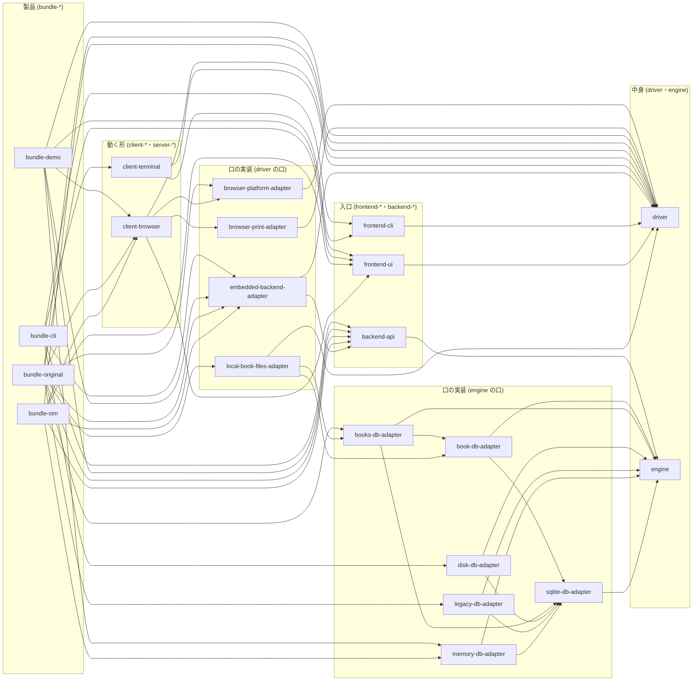

# オープン会計 dependency graph

オープン会計 の箱 (パッケージ) が互いをどう使うかをまとめた図です。
箱の名前は `@rubydogjp/openkk-<箱の名前>` です。箱の種類と中の層は [`architecture.md`](./architecture.md) にあります。

## Mermaid graph

GitHub・VSCode の Markdown preview で Mermaid がそのまま render されます。
LR (left-to-right) 方向: 左ほど製品に近く、右ほど中身に近い。



## グループ説明

| Group                            | 役割                                                                                                       |
| -------------------------------- | ---------------------------------------------------------------------------------------------------------- |
| **製品 (bundle-\*)**             | 動く形・口の実装・設定を選んで束ねた、利用者から見た 1 つの製品                                            |
| **動く形 (client-_・server-_)**  | 入口を、ある環境で動かすための薄い箱                                                                       |
| **入口 (frontend-_・backend-_)** | 中身を、画面 (ui)・コマンド (cli)・呼び出し (api) のどれかの形で受けるもの                                 |
| **口の実装 (driver の口)**       | `driver` が外に求める口 (backend・print・platform・book-files) の実装。利用側は backend の実装を差し替える |
| **口の実装 (engine の口)**       | `engine` が外に求める口 (db) の実装。サーバーを別に持つ製品では使わない                                    |
| **中身 (driver・engine)**        | 決まり・手続き・外に求める口。`driver` が使う側、`engine` が受ける側。入口の形も、動かす場所も知らない     |

> **利用側が差し替える範囲**
>
> - **製品** → 丸ごと差し替える (自前の製品)
> - **動く形** → そのまま使うか、自前の配線に差し替える
> - **口の実装 (driver の口)** の `embedded-backend-adapter` → 自前の HTTP の実装に差し替える
> - **入口 (frontend-\*)** と `driver` → そのまま使う
> - **backend-api・engine・口の実装 (engine の口)** → サーバーを別に持つ製品では使わない

## 口と実装

中身の箱が外に求める口は **Port**、実装の箱は `<相手>-<口>-adapter` と名付ける。

| 口         | Interface             | 定める箱 | 実装の箱                                                                                                                              |
| ---------- | --------------------- | -------- | ------------------------------------------------------------------------------------------------------------------------------------- |
| backend    | `OpenkkBackendPort`   | `driver` | `embedded-backend-adapter`、利用側の HTTP の実装                                                                                      |
| print      | `PrintPort`           | `driver` | `browser-print-adapter`                                                                                                               |
| platform   | `PlatformPort`        | `driver` | `browser-platform-adapter`                                                                                                            |
| book-files | `OpenkkBookFilesPort` | `driver` | `local-book-files-adapter`                                                                                                            |
| db         | `OpenkkDbPort`        | `engine` | `memory-db-adapter`、`books-db-adapter`、`book-db-adapter`、`disk-db-adapter`、`legacy-db-adapter` (共通の実装は `sqlite-db-adapter`) |

## Per-package table

| Package                                      | Group          | Depends on                                                                                                                                                                                                                                                                                                                                              | Depended by                                                                                                                                                                                                                                                                                                                                                                                                                           |
| -------------------------------------------- | -------------- | ------------------------------------------------------------------------------------------------------------------------------------------------------------------------------------------------------------------------------------------------------------------------------------------------------------------------------------------------------- | ------------------------------------------------------------------------------------------------------------------------------------------------------------------------------------------------------------------------------------------------------------------------------------------------------------------------------------------------------------------------------------------------------------------------------------- |
| `@rubydogjp/openkk-backend-api`              | entry          | `@rubydogjp/openkk-engine`                                                                                                                                                                                                                                                                                                                              | `@rubydogjp/openkk-bundle-cli`, `@rubydogjp/openkk-bundle-demo`, `@rubydogjp/openkk-bundle-original`, `@rubydogjp/openkk-bundle-sim`, `@rubydogjp/openkk-embedded-backend-adapter`                                                                                                                                                                                                                                                    |
| `@rubydogjp/openkk-book-db-adapter`          | engine_adapter | `@rubydogjp/openkk-engine`, `@rubydogjp/openkk-sqlite-db-adapter`                                                                                                                                                                                                                                                                                       | `@rubydogjp/openkk-books-db-adapter`, `@rubydogjp/openkk-local-book-files-adapter`                                                                                                                                                                                                                                                                                                                                                    |
| `@rubydogjp/openkk-books-db-adapter`         | engine_adapter | `@rubydogjp/openkk-book-db-adapter`, `@rubydogjp/openkk-engine`, `@rubydogjp/openkk-sqlite-db-adapter`                                                                                                                                                                                                                                                  | `@rubydogjp/openkk-bundle-original`, `@rubydogjp/openkk-local-book-files-adapter`                                                                                                                                                                                                                                                                                                                                                     |
| `@rubydogjp/openkk-browser-platform-adapter` | driver_adapter | `@rubydogjp/openkk-driver`                                                                                                                                                                                                                                                                                                                              | `@rubydogjp/openkk-bundle-original`, `@rubydogjp/openkk-client-browser`                                                                                                                                                                                                                                                                                                                                                               |
| `@rubydogjp/openkk-browser-print-adapter`    | driver_adapter | `@rubydogjp/openkk-driver`                                                                                                                                                                                                                                                                                                                              | `@rubydogjp/openkk-client-browser`                                                                                                                                                                                                                                                                                                                                                                                                    |
| `@rubydogjp/openkk-bundle-cli`               | bundle         | `@rubydogjp/openkk-backend-api`, `@rubydogjp/openkk-client-terminal`, `@rubydogjp/openkk-disk-db-adapter`, `@rubydogjp/openkk-embedded-backend-adapter`, `@rubydogjp/openkk-frontend-cli`                                                                                                                                                               | —                                                                                                                                                                                                                                                                                                                                                                                                                                     |
| `@rubydogjp/openkk-bundle-demo`              | bundle         | `@rubydogjp/openkk-backend-api`, `@rubydogjp/openkk-client-browser`, `@rubydogjp/openkk-driver`, `@rubydogjp/openkk-embedded-backend-adapter`, `@rubydogjp/openkk-frontend-ui`, `@rubydogjp/openkk-memory-db-adapter`                                                                                                                                   | —                                                                                                                                                                                                                                                                                                                                                                                                                                     |
| `@rubydogjp/openkk-bundle-original`          | bundle         | `@rubydogjp/openkk-backend-api`, `@rubydogjp/openkk-books-db-adapter`, `@rubydogjp/openkk-browser-platform-adapter`, `@rubydogjp/openkk-client-browser`, `@rubydogjp/openkk-driver`, `@rubydogjp/openkk-embedded-backend-adapter`, `@rubydogjp/openkk-frontend-ui`, `@rubydogjp/openkk-legacy-db-adapter`, `@rubydogjp/openkk-local-book-files-adapter` | —                                                                                                                                                                                                                                                                                                                                                                                                                                     |
| `@rubydogjp/openkk-bundle-sim`               | bundle         | `@rubydogjp/openkk-backend-api`, `@rubydogjp/openkk-client-browser`, `@rubydogjp/openkk-driver`, `@rubydogjp/openkk-embedded-backend-adapter`, `@rubydogjp/openkk-frontend-ui`, `@rubydogjp/openkk-memory-db-adapter`                                                                                                                                   | —                                                                                                                                                                                                                                                                                                                                                                                                                                     |
| `@rubydogjp/openkk-client-browser`           | runtime        | `@rubydogjp/openkk-browser-platform-adapter`, `@rubydogjp/openkk-browser-print-adapter`, `@rubydogjp/openkk-driver`, `@rubydogjp/openkk-frontend-ui`                                                                                                                                                                                                    | `@rubydogjp/openkk-bundle-demo`, `@rubydogjp/openkk-bundle-original`, `@rubydogjp/openkk-bundle-sim`                                                                                                                                                                                                                                                                                                                                  |
| `@rubydogjp/openkk-client-terminal`          | runtime        | `@rubydogjp/openkk-driver`, `@rubydogjp/openkk-frontend-cli`                                                                                                                                                                                                                                                                                            | `@rubydogjp/openkk-bundle-cli`                                                                                                                                                                                                                                                                                                                                                                                                        |
| `@rubydogjp/openkk-disk-db-adapter`          | engine_adapter | `@rubydogjp/openkk-engine`, `@rubydogjp/openkk-sqlite-db-adapter`                                                                                                                                                                                                                                                                                       | `@rubydogjp/openkk-bundle-cli`                                                                                                                                                                                                                                                                                                                                                                                                        |
| `@rubydogjp/openkk-driver`                   | core           | —                                                                                                                                                                                                                                                                                                                                                       | `@rubydogjp/openkk-browser-platform-adapter`, `@rubydogjp/openkk-browser-print-adapter`, `@rubydogjp/openkk-bundle-demo`, `@rubydogjp/openkk-bundle-original`, `@rubydogjp/openkk-bundle-sim`, `@rubydogjp/openkk-client-browser`, `@rubydogjp/openkk-client-terminal`, `@rubydogjp/openkk-embedded-backend-adapter`, `@rubydogjp/openkk-frontend-cli`, `@rubydogjp/openkk-frontend-ui`, `@rubydogjp/openkk-local-book-files-adapter` |
| `@rubydogjp/openkk-embedded-backend-adapter` | driver_adapter | `@rubydogjp/openkk-backend-api`, `@rubydogjp/openkk-driver`                                                                                                                                                                                                                                                                                             | `@rubydogjp/openkk-bundle-cli`, `@rubydogjp/openkk-bundle-demo`, `@rubydogjp/openkk-bundle-original`, `@rubydogjp/openkk-bundle-sim`                                                                                                                                                                                                                                                                                                  |
| `@rubydogjp/openkk-engine`                   | core           | —                                                                                                                                                                                                                                                                                                                                                       | `@rubydogjp/openkk-backend-api`, `@rubydogjp/openkk-book-db-adapter`, `@rubydogjp/openkk-books-db-adapter`, `@rubydogjp/openkk-disk-db-adapter`, `@rubydogjp/openkk-legacy-db-adapter`, `@rubydogjp/openkk-memory-db-adapter`, `@rubydogjp/openkk-sqlite-db-adapter`                                                                                                                                                                  |
| `@rubydogjp/openkk-frontend-cli`             | entry          | `@rubydogjp/openkk-driver`                                                                                                                                                                                                                                                                                                                              | `@rubydogjp/openkk-bundle-cli`, `@rubydogjp/openkk-client-terminal`                                                                                                                                                                                                                                                                                                                                                                   |
| `@rubydogjp/openkk-frontend-ui`              | entry          | `@rubydogjp/openkk-driver`                                                                                                                                                                                                                                                                                                                              | `@rubydogjp/openkk-bundle-demo`, `@rubydogjp/openkk-bundle-original`, `@rubydogjp/openkk-bundle-sim`, `@rubydogjp/openkk-client-browser`                                                                                                                                                                                                                                                                                              |
| `@rubydogjp/openkk-legacy-db-adapter`        | engine_adapter | `@rubydogjp/openkk-engine`, `@rubydogjp/openkk-sqlite-db-adapter`                                                                                                                                                                                                                                                                                       | `@rubydogjp/openkk-bundle-original`                                                                                                                                                                                                                                                                                                                                                                                                   |
| `@rubydogjp/openkk-local-book-files-adapter` | driver_adapter | `@rubydogjp/openkk-book-db-adapter`, `@rubydogjp/openkk-books-db-adapter`, `@rubydogjp/openkk-driver`                                                                                                                                                                                                                                                   | `@rubydogjp/openkk-bundle-original`                                                                                                                                                                                                                                                                                                                                                                                                   |
| `@rubydogjp/openkk-memory-db-adapter`        | engine_adapter | `@rubydogjp/openkk-engine`, `@rubydogjp/openkk-sqlite-db-adapter`                                                                                                                                                                                                                                                                                       | `@rubydogjp/openkk-bundle-demo`, `@rubydogjp/openkk-bundle-sim`                                                                                                                                                                                                                                                                                                                                                                       |
| `@rubydogjp/openkk-sqlite-db-adapter`        | engine_adapter | `@rubydogjp/openkk-engine`                                                                                                                                                                                                                                                                                                                              | `@rubydogjp/openkk-book-db-adapter`, `@rubydogjp/openkk-books-db-adapter`, `@rubydogjp/openkk-disk-db-adapter`, `@rubydogjp/openkk-legacy-db-adapter`, `@rubydogjp/openkk-memory-db-adapter`                                                                                                                                                                                                                                          |

## 再生成

```bash
cd openkk
npm run gen-deps
```
